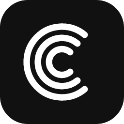
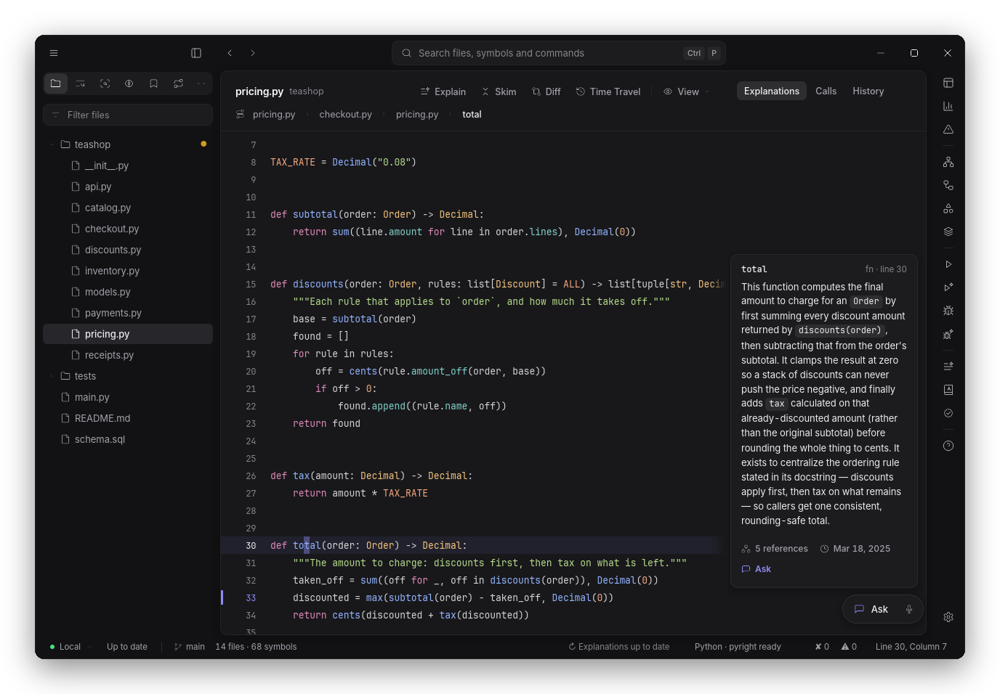
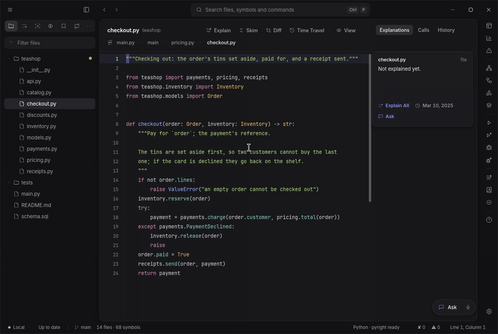
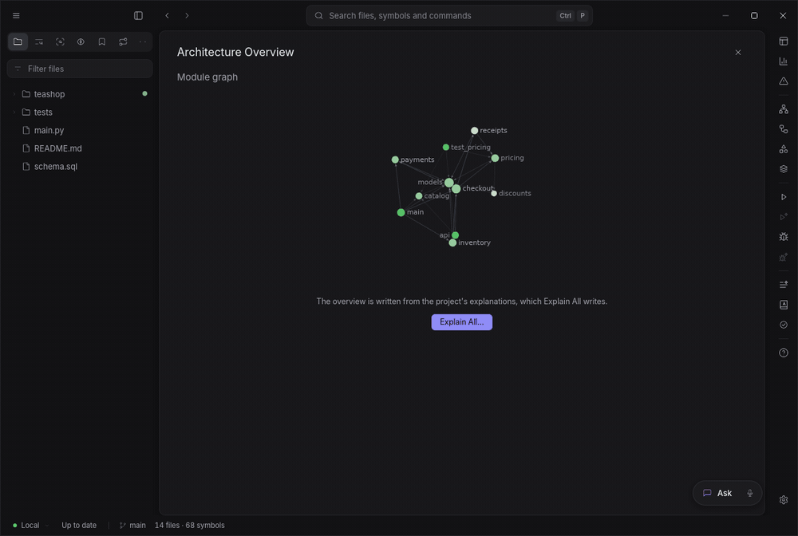
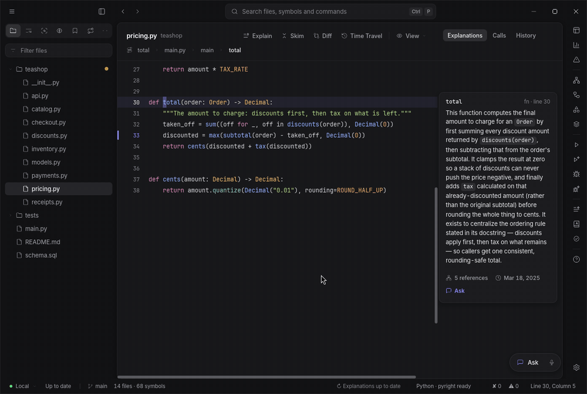
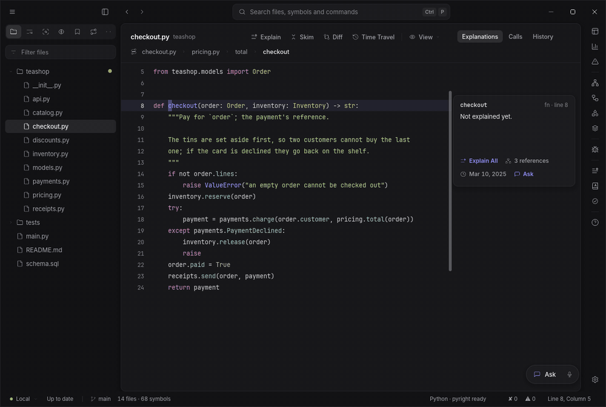
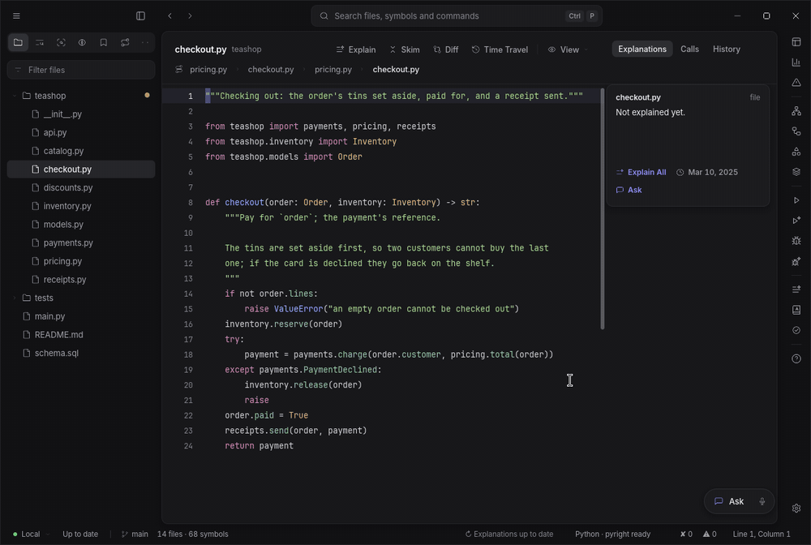
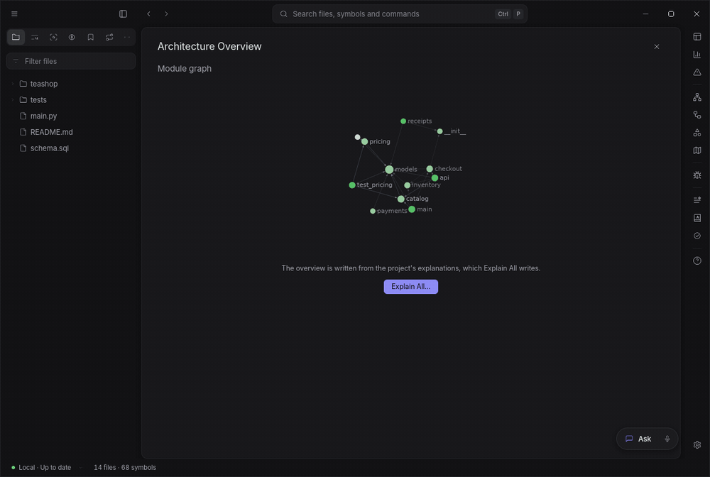

# Clew

**Read any codebase like the person who wrote it.**

**English** · [简体中文](README.zh-CN.md)

Your IDE is where you write code. 
Clew is an **IUE**, an *Integrated Understanding Environment*, where you understand it.

## Highlights

- **Essential Features Given by IDEs**

  All essential features provided by IDEs are also given by Clew, such as language servers, tree-sitter, debug, and more.

  

- **Understand Code Comprehensively**

  Clew provides features, such as *architecture overview, codebase statistics,* *call graph, type graph, project graph, glossary, and more, to help you* *comprehensively understand any codebase.*

  

- **Understand Code in Detail**

  Clew provides features, such as *walkthrough,* *call hierarchy, semantic search,* *debug, run, fake debug, fake run, code explanation, time travel, and more, to* *help you comprehensively understand any codebase.*

  

- **AI Onside**

  Clew has a built-in AI agent with MCP and ACP supported.

  

- **Voice Mode**

  With voice mode, you can use Clew without using mouse or keyboard, in which you speak to Clew and the AI agent inside will operate Clew for you and also answer you in voice.

  

- **Jump Mode**

  With jump mode, you can goes anywhere and use any features with only keyboard.

  

## Get started

1. **Download** the [latest release](https://github.com/RutaTang/Clew/releases/latest): the `.dmg` for macOS (Apple silicon) or the `.tar.gz` for Linux (x86-64).
2. **Open a folder** with the code you want to read, and add your model's key in **Settings → Language model**.
3. **Take the tour**: **⌘⇧U** (Ctrl+Shift+U on Linux) walks you through Clew on a small sample project.

On Linux, Clew needs ALSA (`libasound2`) and an X11 or Wayland desktop. Unpack the archive anywhere and run `clew`, keeping `clew-server` and `clew-speak` beside it.

## Learn more

[Keyboard](docs/keyboard.md) · [Voice](docs/voice.md) · [MCP and ACP](docs/mcp-acp.md) · [Language support](docs/languages.md) · [Project graphs](docs/project-graphs.md)

## Contributing

Clew is young, and every issue, idea and pull request helps: [open one](https://github.com/RutaTang/Clew/issues).
