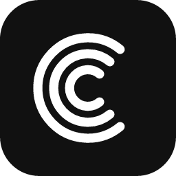
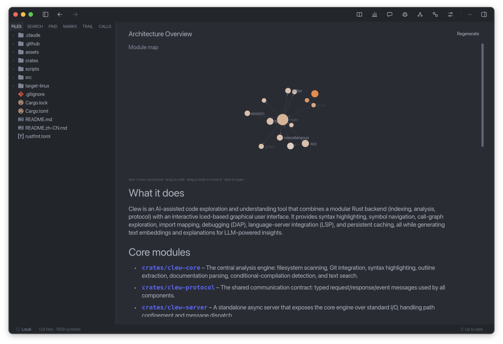
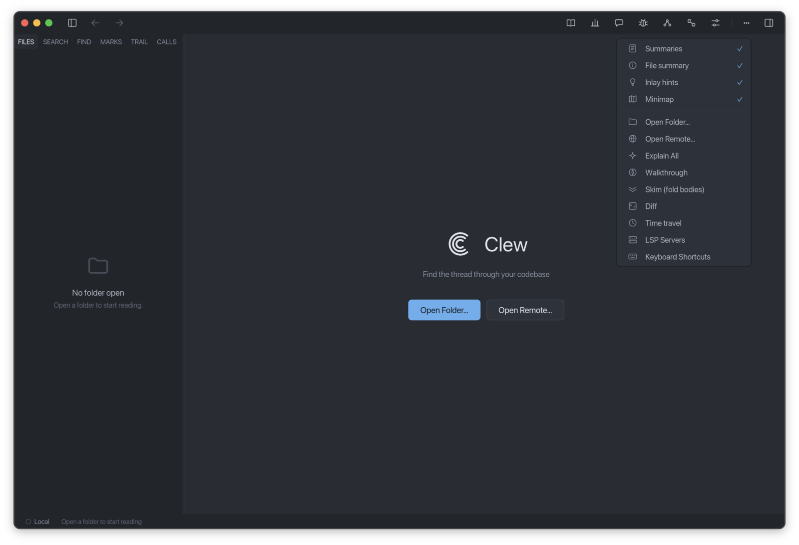

<div align="center">



# Clew

**一个 AI 驱动的「代码分析和阅读」工具**

[](https://github.com/RutaTang/Clew/actions/workflows/ci.yml) &nbsp; [](https://github.com/RutaTang/Clew/releases/latest) &nbsp; [](https://github.com/RutaTang/Clew/releases) &nbsp;  &nbsp;  &nbsp; [](https://github.com/RutaTang/Clew/stargazers) &nbsp; [](https://github.com/RutaTang/Clew/pulls)

[English](README.md) &nbsp;|&nbsp; **简体中文**

随着 LLMs 的发展，AI 已经能在很大程度上写 Repo 级别的代码了。因为我们近乎都是用自然语言驱动 AI 编写代码，和程序语义不同，我们难以避免自然语言阐述代码时可能带来的语义模糊和歧义。因此，对于我们来说，阅读、理解和分析代码仍然是必要。Clew 就是为此设计的。



</div>

## 简介

Clew 不是编辑器，而是专门为**阅读、理解和分析代码**而设计的工具。

无论是想通过阅读现有代码去**快速读懂并上手一个陌生项目**、学习它的结构与实现，还是想仔细阅读、理解、分析 **AI 写的代码**，确认它的程序语义和你的本意一致、并检查有没有 bug，Clew 都能帮到你。

不同于 Editor 或 IDE，Clew 内建了多种为「读代码」而生的能力。既有 import graph、call graph、reading trail、bookmarks、symbol-aware notes、codebase statistics、LSP、debugger 这些**非 AI 功能**，也有 Architecture Overview、Ask Clew、Explain、Semantic Search、Walkthroughs 这些 **AI 驱动功能**。

## 快速开始

从 [Releases](https://github.com/RutaTang/Clew/releases/latest) 下载最新的 Clew 版本。进入初始页面，点击 Open Folder，打开你要阅读的代码库。点击右上角的「⋯」按钮展开菜单，点击 Tutorial 按钮，Clew 会在你打开的项目上为你介绍如何使用 Clew。



## 功能总览

- 🗺️ **项目全貌**：从整体和宏观的视角看一个项目，能帮我们理解它总体上是什么、由怎样的架构组成、为什么这样设计。Clew 提供一个由 AI 驱动的 Architecture Overview 功能以及一个 Code Statistics 功能，帮你抓住主要架构，从总体上理解这个项目。
- 💬 **Ask Clew**：读代码时总会冒出各种具体问题，比如「Authentication 在哪做的?」「这里为什么要这样写?」等。Clew 提供一个懂你整个项目的 AI Agent，它会结合项目内容给你有依据的回答。
- 🕸️ **Call Graph 和 Import Graph**：想弄清模块之间谁依赖谁、函数之间谁调用谁，光读代码很难拼出全貌。Clew 把 import 关系和调用关系画成一张可旋转、自转、拖拽的实时 3D 力布局图，按语言和层级深度着色，用箭头标出依赖方向，成环处还会高亮，让代码的结构一眼可见。
- 🧭 **Walkthrough**：上手一个新项目，不管是想了解项目主要的走向和涉及的代码，还是想知道某个功能主要的走向和涉及的代码，以及从哪里入手，又该按照什么顺序读，往往并不是容易的。Clew 提供了由 AI 驱动的 Walkthrough 功能，能针对整个项目或某个具体问题，生成一条有序、锚定到代码的引导式讲解，带你一步步走过关键的文件和函数，理清阅读的主线。
- 🕰️ **Time Travel**：对于一段代码想不通为什么这么写时，往往需要回头看它以前长什么样、是什么时候、为什么变成现在这样。Clew 提供 Time Travel 功能，沿着时间轴拖动，就能把任意文件回退到它 git 历史里的任一版本。针对某个函数，它还能生成一段由 AI 驱动的 story，解释这个函数从历史一步步变成现在这样的原因。
- 🔌 **多模型支持**：Clew 的 AI 功能背后是一个可替换的语言模型，不绑定任何一家厂商。你可以在设置里填入自己的 LLM Provider 的 API key 和 endpoint。
- 🧩 **MCP 与 ACP**：Ask Clew 可以调用你自己的 **MCP** 服务器提供的工具（issue 跟踪、文档、数据库等），也可以把问题交给支持 **ACP** 的编码 agent（Claude Agent、Codex、Gemini CLI、GitHub Copilot 等）来回答。反过来，Clew 也通过 MCP 把它的代码理解工具提供给任何 agent，并通过 ACP 把它自己的 agent 提供给编辑器。

## MCP 与 ACP

**在 Ask Clew 中使用 MCP 服务器。** 在 **设置 → MCP servers** 中，通过命令（`npx -y @modelcontextprotocol/server-github`）、URL（`https://…/mcp`），或直接粘贴服务器 README 里的 `{"mcpServers": {…}}` 片段来添加服务器。Clew 同时支持最新的无状态 MCP 版本（2026-07-28）和更早基于 `initialize` 的版本（2025-11-25 到 2024-11-05），传输方式支持 stdio 和 Streamable HTTP。需要登录的远程服务器（MCP 的 OAuth 流程）会显示 **Sign in** 按钮，在浏览器中完成登录；令牌保存在你的机器上，过期时会自动续期。每次工具调用都会先征得你的同意（并显示参数），除非你对该工具选择“始终允许”，或者把该服务器设置为信任只读工具或全部调用。配置保存在 `config.toml` 中：

```toml
[mcp.servers.github]
command = "npx"
args = ["-y", "@modelcontextprotocol/server-github"]
env = { GITHUB_PERSONAL_ACCESS_TOKEN = "…" }
approve = "ask"            # ask | read_only | always
allow = ["search_code"]    # 不需要询问的工具
timeout_secs = 120

[mcp.servers.docs]
url = "https://example.com/mcp"
headers = { Authorization = "Bearer …" }
```

**在 Ask 面板中使用 ACP agent。** 在 **设置 → ACP agents** 中添加 agent（内置 Claude Agent、Codex、Gemini CLI、GitHub Copilot、Qwen Code 和 OpenCode 预设，或任何以 ACP 模式启动 agent 的命令），然后在 Ask 面板中选择它。agent 在你的机器上、在项目目录中运行，并可以使用 Clew 的代码工具；它的计划、工具调用和回答会实时显示在面板中，需要权限时也在面板中由你确认。ACP agent 适用于本地项目。

**把 Clew 作为 MCP 服务器。** `clew-server mcp` 通过 stdio 为其所在目录（或 `--root <dir>` 指定的目录）提供工具：精确与语义搜索、读取文件与大纲、基于语言服务器的定义、引用与悬停信息、git 历史与当前改动，以及项目已缓存的解释。例如在 Claude Code 中：

```sh
claude mcp add clew -- /Applications/Clew.app/Contents/MacOS/clew-server mcp
```

**把 Clew 作为 ACP agent。** `clew-server acp` 把 Ask Clew 的 agent 提供给支持 ACP agent 的编辑器，使用 Clew 设置中配置的模型来回答。编辑器传入的 MCP 服务器也会加入它的工具，每次调用都会先征得你的同意。例如在 Zed 的 `settings.json` 中：

```json
"agent_servers": {
  "Clew": { "command": "/Applications/Clew.app/Contents/MacOS/clew-server", "args": ["acp"] }
}
```

## 语言支持

为了更好地做代码分析，Clew 会针对不同语言的特性，提供贴合它的支持。目前 Clew 提供的功能对 Rust、Python、TypeScript/JavaScript、Go 和 Dart 这 6 种语言支持良好，对其余语言目前也提供了一些基础支持，如语法高亮。未来会支持更多语言。

## 贡献

目前 Clew 项目仍然处于早期，我们欢迎和期盼各种建议，如功能需求、报告 bugs、PR 等。
