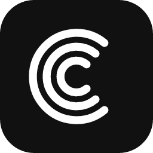
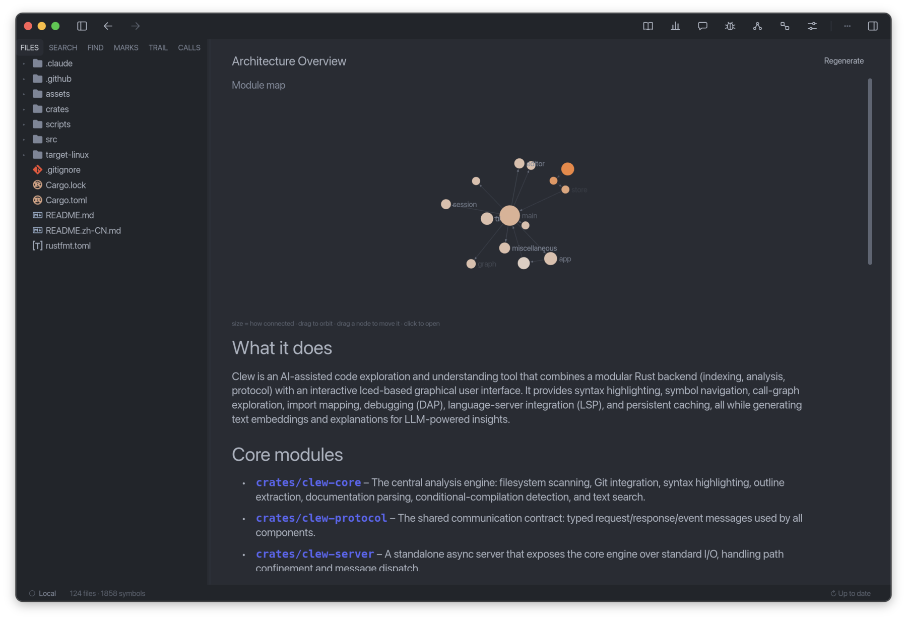
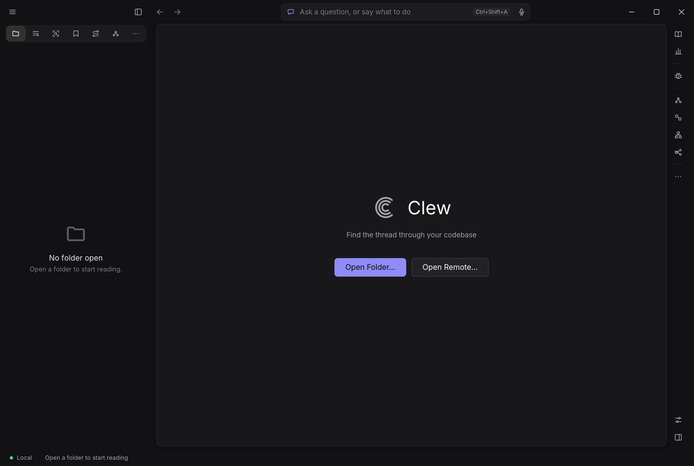

<div align="center">



# Clew

**一个 AI 驱动的「代码分析和阅读」工具**

[](https://github.com/RutaTang/Clew/actions/workflows/ci.yml) &nbsp; [](https://github.com/RutaTang/Clew/releases/latest) &nbsp; [](https://github.com/RutaTang/Clew/releases) &nbsp;  &nbsp;  &nbsp; [](https://github.com/RutaTang/Clew/stargazers) &nbsp; [](https://github.com/RutaTang/Clew/pulls)

[English](README.md) &nbsp;|&nbsp; **简体中文**

随着 LLMs 的发展，AI 已经能在很大程度上写 Repo 级别的代码了。因为我们近乎都是用自然语言驱动 AI 编写代码，和程序语义不同，我们难以避免自然语言阐述代码时可能带来的语义模糊和歧义。因此，对于我们来说，阅读、理解和分析代码仍然是必要。Clew 就是为此设计的。



</div>

## 简介

Clew 不是编辑器，而是专门为**阅读、理解和分析代码**而设计的工具。

无论是想通过阅读现有代码去**快速读懂并上手一个陌生项目**、学习它的结构与实现，还是想仔细阅读、理解、分析 **AI 写的代码**，确认它的程序语义和你的本意一致、并检查有没有 bug，Clew 都能帮到你。

不同于 Editor 或 IDE，Clew 内建了多种为「读代码」而生的能力。既有 import graph、call graph、reading trail、bookmarks、symbol-aware notes、codebase statistics、LSP、debugger 这些**非 AI 功能**，也有 Architecture Overview、Ask Clew、Explain、Semantic Search、Walkthroughs 这些 **AI 驱动功能**。

## 快速开始

从 [Releases](https://github.com/RutaTang/Clew/releases/latest) 下载最新的 Clew 版本：macOS（Apple 芯片）下载 `.dmg`，Linux 下载 `.tar.gz`（x86-64；解压到任意位置后运行 `clew`，`clew-server` 要和它放在一起）。Linux 上需要 ALSA 的库（`libasound2`，桌面系统都自带）和 X11 或 Wayland 桌面。进入初始页面，点击 Open Folder，打开你要阅读的代码库。点击右上角的「⋯」按钮展开菜单，点击 Tutorial 按钮，Clew 会在你打开的项目上为你介绍如何使用 Clew。

Clew 的每个功能也都可以只用键盘完成（Linux 和 Windows 上 **⌘** 即 **Ctrl**）：按 **⌘⇧P** 打开命令面板，搜索任意命令（图谱和地图、侧边栏的标签页和各个面板、右键菜单在光标处的操作、调试器的控制、主题），按回车执行。在文件查找（⌘P）里输入 `>` 也一样，**⌘/** 列出所有快捷键。也可以直接说：**⌘⇧S** 会听你说命令或问题（见 [语音](#语音)）。



## 功能总览

- 🗺️ **项目全貌**：从整体和宏观的视角看一个项目，能帮我们理解它总体上是什么、由怎样的架构组成、为什么这样设计。Clew 提供一个由 AI 驱动的 Architecture Overview 功能以及一个 Code Statistics 功能，帮你抓住主要架构，从总体上理解这个项目。
- 💬 **Ask Clew**：读代码时总会冒出各种具体问题，比如「Authentication 在哪做的?」「这里为什么要这样写?」等。Clew 提供一个懂你整个项目的 AI Agent，它会结合项目内容给你有依据的回答。Ask 属于整个项目，所以它在窗口右下角（**⌘⇧A**）：平时是一个小胶囊，打开后是那里的一张卡片，不挡住它上方和左边的代码；也可以放大成居中的窗口，按 Esc 一步步退回到胶囊。窗口顶部的输入框用来搜索文件、符号，以及以 `>` 开头的命令。Agent 还能直接在窗口里动手：打开某个文件的某一行、跳到某个符号、执行命令面板里的任意命令（「给我看调用图」），有代价的命令会先征得你的同意。
- 🎙️ **语音**：按 **⌘⇧S**（或 Ask 上的麦克风）直接说话：说一个命令（「open the call graph」「hide the minimap」「dark mode」）就会执行；问一个问题就会交给 Ask。语音识别**在你自己的电脑上**由 [whisper.cpp](https://github.com/ggml-org/whisper.cpp) 完成，你说的话不会离开这台电脑；模型在 **设置 → Voice** 中挑选并下载一次即可：Echo 自己的三个（Small、Medium、Large，即 whisper 的 `small-q5_1`、`large-v3-turbo-q5_0`、`large-v3-q5_0`），或小巧的纯英文模型，每个都会用公布的校验和核对。详见 [语音](#语音)。
- 🕸️ **Call Graph 和 Import Graph**：想弄清模块之间谁依赖谁、函数之间谁调用谁，光读代码很难拼出全貌。Clew 把 import 关系和调用关系画成一张可旋转、自转、拖拽的实时 3D 力布局图，按语言和层级深度着色，用箭头标出依赖方向，成环处还会高亮，让代码的结构一眼可见。
- 🧱 **项目地图（Project maps）**：一个项目怎样组织在一起，很多是用它的语言和框架自己的说法写下的，import 图和调用图都看不出来：数据库有哪些表，Web 应用有哪些路由，Spring 往哪里注入了什么，OTP 的监督树，Go 类型不声明就满足了哪些接口。Clew 从文件里读出这些，把每一种画成一张地图，每个节点都能打开它定义的地方（见[项目地图](#项目地图)）。
- 🧭 **Walkthrough**：上手一个新项目，不管是想了解项目主要的走向和涉及的代码，还是想知道某个功能主要的走向和涉及的代码，以及从哪里入手，又该按照什么顺序读，往往并不是容易的。Clew 提供了由 AI 驱动的 Walkthrough 功能，能针对整个项目或某个具体问题，生成一条有序、锚定到代码的引导式讲解，带你一步步走过关键的文件和函数，理清阅读的主线。
- 🕰️ **Time Travel**：对于一段代码想不通为什么这么写时，往往需要回头看它以前长什么样、是什么时候、为什么变成现在这样。Clew 提供 Time Travel 功能，沿着时间轴拖动，就能把任意文件回退到它 git 历史里的任一版本。针对某个函数，它还能生成一段由 AI 驱动的 story，解释这个函数从历史一步步变成现在这样的原因。
- 🔌 **多模型支持**：Clew 的 AI 功能背后是一个可替换的语言模型，不绑定任何一家厂商。你可以在设置里填入自己的 LLM Provider 的 API key 和 endpoint。
- 🌐 **多语言界面**：Clew 支持英语、法语、简体中文、韩语和日语界面，默认跟随系统语言，也可以在 **设置 → 外观 → 语言** 中切换；AI 的回答、讲解和导览也会使用同一种语言。
- 🧩 **MCP 与 ACP**：Ask Clew 可以调用你自己的 **MCP** 服务器提供的工具（issue 跟踪、文档、数据库等），也可以把问题交给支持 **ACP** 的编码 agent（Claude Agent、Codex、Gemini CLI、GitHub Copilot 等）来回答。反过来，Clew 也通过 MCP 把它的代码理解工具提供给任何 agent，并通过 ACP 把它自己的 agent 提供给编辑器。

## MCP 与 ACP

**在 Ask Clew 中使用 MCP 服务器。** 在 **设置 → MCP servers** 中，通过命令（`npx -y @modelcontextprotocol/server-github`）、URL（`https://…/mcp`），或直接粘贴服务器 README 里的 `{"mcpServers": {…}}` 片段来添加服务器。Clew 同时支持最新的无状态 MCP 版本（2026-07-28）和更早基于 `initialize` 的版本（2025-11-25 到 2024-11-05），传输方式支持 stdio 和 Streamable HTTP。需要登录的远程服务器（MCP 的 OAuth 流程）会显示 **Sign in** 按钮，在浏览器中完成登录；令牌保存在你的机器上，过期时会自动续期。每次工具调用都会先征得你的同意（并显示参数），除非你对该工具选择“始终允许”，或者把该服务器设置为信任只读工具或全部调用。配置保存在 `config.toml` 中：

```toml
[mcp.servers.github]
command = "npx"
args = ["-y", "@modelcontextprotocol/server-github"]
env = { GITHUB_PERSONAL_ACCESS_TOKEN = "…" }
approve = "ask"            # ask | read_only | always
allow = ["search_code"]    # 不需要询问的工具
timeout_secs = 120

[mcp.servers.docs]
url = "https://example.com/mcp"
headers = { Authorization = "Bearer …" }
```

**在 Ask 面板中使用 ACP agent。** 在 **设置 → ACP agents** 中添加 agent（内置 Claude Agent、Codex、Gemini CLI、GitHub Copilot、Qwen Code 和 OpenCode 预设，或任何以 ACP 模式启动 agent 的命令），然后在 Ask 面板中选择它。agent 在你的机器上运行并处理该项目，并可以使用 Clew 的代码工具（agent 和 MCP 服务器从你的主目录启动，或从配置项的 `cwd` 启动，因此项目自带的 `.npmrc` 无法改变 `npx` 运行的内容）；它的计划、工具调用和回答会实时显示在面板中，需要权限时也在面板中由你确认。ACP agent 适用于本地项目。

**把 Clew 作为 MCP 服务器。** `clew-server mcp` 通过 stdio 为其所在目录（或 `--root <dir>` 指定的目录）提供工具：精确与语义搜索、读取文件与大纲、基于语言服务器的定义、引用与悬停信息、git 历史与当前改动，以及项目已缓存的解释。例如在 Claude Code 中：

```sh
claude mcp add clew -- /Applications/Clew.app/Contents/MacOS/clew-server mcp
```

（Linux 和 Windows 上，`clew-server` 就是解压目录里 `clew` 旁边的那个。）

**把 Clew 作为 ACP agent。** `clew-server acp` 把 Ask Clew 的 agent 提供给支持 ACP agent 的编辑器，使用 Clew 设置中配置的模型来回答。编辑器传入的 MCP 服务器也会加入它的工具，每次调用都会先征得你的同意。例如在 Zed 的 `settings.json` 中：

```json
"agent_servers": {
  "Clew": { "command": "/Applications/Clew.app/Contents/MacOS/clew-server", "args": ["acp"] }
}
```

## 语音

**说话。** 按 **⌘⇧S**（Linux 和 Windows 上是 Ctrl+Shift+S；可以改键，命令面板里叫 **Talk**）或麦克风按钮，然后说出你想做的事。你停顿下来、或再按一次快捷键时，就停止收音；按 **Esc** 取消。听到的内容要么是窗口的某个命令——按你平时的说法说即可，词序随意，带不带「open」「show」都行；有代价的命令（一次 Explain All、启动程序、打开另一个文件夹）会先问你——要么是一个问题，会交给 Ask 并立即提问（这两项都可以在 **设置 → Voice** 中关闭）。

**全在本机。** 麦克风通过系统自己的音频接口读取（Core Audio、WASAPI、ALSA，PipeWire 和 PulseAudio 都支持 ALSA），音频重采样到 16 kHz、裁剪到有人声的部分，再由 whisper.cpp 在这台电脑上转成文字：Mac 上通过 Metal 用 GPU，其他平台用 CPU。不会发送任何内容；只有你选择提问的问题才会像打字提问一样发给你的语言模型。

**模型。** 使用 whisper.cpp 自己的模型，与 [Echo](https://github.com/damien-schneider/Echo) 使用的相同，只有在你点击某个模型的 **Download**（按钮上标有大小）时才会下载，并且只有与公布的文件逐字节一致才会被接受：**Small**（`small-q5_1`，190 MB，默认）、**Medium**（`large-v3-turbo-q5_0`，574 MB）和 **Large**（`large-v3-q5_0`，1081 MB）按 Echo 的方式用 SHA-256 和精确大小核对，三者都支持多语言；另有 Tiny 和 Base（英文），适合在较慢的机器上快速下命令，用 whisper.cpp 列出的 SHA-1 核对。模型保存在 Clew 的数据目录（`voice/`）中，可以在那里删除。在 macOS 上，Clew 第一次收音时，系统会询问是否允许使用麦克风。

语音在 macOS 和 Linux 上的表现一致，Clew 窗口里的其他功能也一样：整个应用在 CI 中于这两个平台上构建并测试，每个版本都为这两个平台发布。

## 语言支持

为了更好地做代码分析，Clew 会针对不同语言的特性，提供贴合它的支持。目前 Clew 提供的功能完整支持 Rust、Python、TypeScript/JavaScript、Go、Dart、Java、C#、PHP、Ruby、Erlang、Haskell 和 Zig；C 和 C++、Lean 4 以及 SQL 支持其中的大部分功能；对其余语言目前也提供了一些基础支持，如语法高亮。未来会支持更多语言。

**设置 → 本项目的语言**会针对当前打开的项目，显示每种语言的语言服务器及其状态，并让你为每种语言做设置——每项设置都先显示当前生效的内容，再列出可选项：

- **Python** —— 语言服务器和调试器所使用的解释器，以及由谁指定（你的选择、项目的 `.clew/lsp.toml`、在项目中找到的虚拟环境）。可以从 Clew 找到的环境中另选一个（项目自身的、Poetry、Pipenv、conda、pyenv、uv，或 `PATH` 上的 `python3`），也可以直接填写路径。
- **Rust** —— rust-analyzer 加载项目时启用的 Cargo features（从各 package 的 `Cargo.toml` 中列出全部 features；也可以全部启用，可选是否带默认 features），以及检查所针对的 target。
- **Go** —— gopls 和调试器构建时使用的 build tags（列出项目中 `//go:build` 行用到的 tags），以及按哪个 `GOOS`/`GOARCH` 阅读项目。
- **C 和 C++** —— clangd 使用的 `compile_commands.json`（列出 CMake、Meson 等在项目中生成的那些），以及编译数据库未覆盖的文件所用的编译参数（如 `-DDEBUG -Iinclude -std=c++20`）。
- **Lean 和 Dart** —— 语言服务器所用的工具链：elan 安装的各个工具链（项目 `lean-toolchain` 指定的排在最前）、Flutter SDK 以及 fvm 管理的各个版本（项目指定的排在最前）。
- **TypeScript 和 JavaScript** —— 语言服务器所运行的 TypeScript：默认使用 Clew 自带的版本，除非你主动选择，否则绝不会使用项目自带的版本（列表中会标出它的版本，并注明它会运行项目自身的代码），也可以选择全局安装的版本。
- **Zig** —— zls 所使用的 `zig` 编译器：zvm 和 zigup 管理的各个版本（项目 `build.zig.zon` 要求的版本排在最前），或你指定的编译器。
- **Java** —— Eclipse JDT 语言服务器构建项目所用的 JDK：本机上的各个 JDK（`JAVA_HOME`、`/usr/lib/jvm`、macOS、SDKMAN!、IntelliJ、asdf、mise 和 Homebrew 安装的），构建要求的 Java 版本（`.java-version`、`.sdkmanrc`、Gradle 工具链、`pom.xml`）对应的排在最前。
- **PHP** —— intelephense 按哪个 PHP 版本解读代码（`composer.json` 允许的最低版本排在最前）。
- **C#** —— csharp-ls 打开的解决方案：项目根目录及下一级目录中的 `.sln` 和 `.slnx` 文件。
- **Ruby、Erlang 和 Haskell** —— 选用哪个 Ruby 的 Ruby LSP（rbenv、chruby、asdf、mise、RVM 安装的；项目 `.ruby-version` 指定的排在最前），以及要运行的 ELP 和 Haskell 语言服务器（ghcup、Stack、Cabal 安装的），或 `PATH` 上的。
- **任意语言** —— 使用你自己的语言服务器程序：另一个版本的 Clew 自带服务器、另一种服务器，或为 Clew 尚无服务器的语言指定一个。会构建项目的服务器在构建前仍会先征得你的同意。

以上内容都只通过读取文件得到——不会运行任何程序；远程项目则在其所在主机上查找。这些选择保存在 Clew 自己的数据目录中，只对本机上的这个项目生效，绝不会写入项目，优先于项目的 `lsp.toml`，并同样作用于编辑器的语言服务器、调试器以及 Ask 的代码工具。

构建因此不会编译的代码会在阅读时变暗：Rust 中依赖未启用 feature（或其他平台）的 `cfg` 项、`//go:build` 行或 `_windows.go` 这类文件名所排除的 Go 文件，按平台和 `-D`/`-U` 参数会被预处理器丢弃的 C/C++ `#if`/`#ifdef` 分支，Zig 中基于 `builtin.os.tag` 或 `builtin.cpu.arch` 的 comptime `if`/`switch` 分支里编译器不会为该平台分析的部分，C# 中依据文件自身 `#define` 的符号判定不成立的 `#if` 分支，Haskell 中（启用了 CPP 的文件）基于 `<os>_HOST_OS` 和 `<arch>_HOST_ARCH` 的 CPP `#if` 分支，以及 Erlang 中依据文件自身 `-define` 的宏判定不成立的 `-ifdef`/`-if` 分支。与平台有关的判断，以状态栏中选定的平台为准。只有确定不会编译的代码才会变暗——可能由其他 package 启用的 feature、可能由头文件定义的宏，都不会被处理。

- **SQL**：大纲列出 schema 中的表（及其列）、视图、函数、触发器和类型，并以其上方的 `--` 注释作为文档；类型图会按外键把表连接起来（无论外键写在表定义中，还是像 `pg_dump` 那样写在同一文件的 `ALTER TABLE` 里），并把每个视图连向它所查询的表。
- **Java、C#、PHP、Ruby、Erlang、Haskell 和 Zig**：语法高亮；大纲，每个定义附带其文档（Javadoc、C# 的 `///` XML 文档、PHPDoc、Ruby 的 `#` 注释、EDoc、Haddock、Zig 的 `///`），并标出测试（JUnit、NUnit/xUnit/MSTest、PHPUnit、Minitest、EUnit、Zig 的 `test` 块）；导入图；调用图；以及语言服务器（Eclipse JDT LS、csharp-ls、intelephense、Ruby LSP、ELP、Haskell 语言服务器、zls）。调试器用 rdbg（`debug` gem；所选 Ruby 自带的那个）运行 Ruby 程序，用 netcoredbg 运行 .NET 程序集，把 Zig 程序当作原生代码交给 lldb-dap（`.zig` 文件会在本次调试中经 LLVM 编译，即 `-fllvm`，lldb 能读取其调试信息；由 Zig 自带代码生成器——x86-64 上 Debug 构建的默认方式——生成的二进制同样可以调试，但 lldb 无法从中读取变量，调试控制台会说明这一点以及如何构建出它能读取的版本）；并通过 Clew 自带的调试适配器，经 JDWP 调试 Java 程序（只需项目选定的 JDK：`.java` 文件会在本次调试中编译；构建出的程序以 `mainClass` 和 `classPaths` 指定；断点在其类加载时设置；可读取局部变量、字段、数组与字符串；JDWP 本身不求值，Clew 便在其上自行计算 Java 表达式——名字、字段、元素、字面量、算术、比较与逻辑运算、字符串拼接，以及 `order.total()`、`Math.max(a, b)`、`items.get(0) * 2` 这样的调用，按 Java 的规则选择重载并装箱或拆箱，方法只在已停下的线程中运行，途中遇到的断点会被跳过；悬停时不调用任何方法，暂停时也不调用，因为此时虚拟机不运行方法），用 Xdebug 3 调试 PHP 程序、用 OTP 的解释器调试 Erlang 程序（模块的 `main/1`，或启动配置指定的入口；其应用会在本次调试中以 `debug_info` 编译）、用 GHCi 的调试器调试 Haskell 程序（源码目录取自项目的 `.cabal` 或 `package.yaml`；启动配置也可改用 `cabal repl` 或 `stack repl`）。断点、单步、调用栈、变量和求值在这些语言中都可使用，以各语言自身调试器的能力为限：Erlang 和 Java 可以暂停正在运行的程序；PHP 在 Linux 上使用 Xdebug 3.4 及以上版本时（通过 Xdebug 的控制套接字），或在程序运行时仍接受命令的 Xdebug 下，也可以；GHCi 通过逐步执行直到函数返回来实现单步跳出，但无法暂停程序。以上全部在远程主机上同样可用：在该主机端口上监听的调试适配器（rdbg、Go 的 delve）由 Clew 的服务端通过自己的连接转发；Node.js 程序则由服务端自带的适配器经 Node 的 inspector 调试——Clew 在本机使用的 vscode-js-debug 会为每个被调试进程单独建立连接，远程通道无法承载。它支持带条件的断点、单步、真正的暂停（停在程序自己的代码中，而非 Node 内部）、已捕获与未捕获的异常、各作用域的变量，以及由 V8 自身完成的求值（悬停时不允许任何副作用）；TypeScript 按 Node 22.6 及以上版本的方式运行，类型在原位被剥除，因此每一行都与源码对应；它跟随主线程，不跟随 worker 或子进程。远程项目的 `composer.json` 和 Haskell 包描述文件在其所在主机上读取，因此其导入的解析与本地项目一致。导入按各语言的构建方式解析：Java 的包在项目的源码根目录（`src/main/java`）下查找，C# 的 `using` 指向项目文件所声明的命名空间，PHP 的类按 `composer.json` 的 PSR-4 映射及其 `require` 路径解析，Ruby 的 `require_relative` 以及从 `lib/` 解析的 `require`，Erlang 的 `-include`/`-include_lib` 与 `-behaviour`，Haskell 的模块在 `.cabal` 或 `package.yaml` 的源码目录下查找，Zig 的 `@import` 按路径解析；不属于项目的（JDK、NuGet、Composer 包、gem、OTP、Hackage、`std`）按包列出。
- **Lean 4**：大纲（定义、定理、实例、结构体、类、归纳类型）及其 `/-- … -/` 文档与文件的 `/-! … -/` 模块文档、导入图、类型图中 `extends` 其他结构体的继承关系，以及 Lean 语言服务器（`lake serve`，来自 elan 安装的 Lean 工具链）。Lean 的语法可扩展，因此 clew 的语法解析器读不懂的命令会按其首行列入大纲，且不会影响其他命令的大纲。

## 项目地图

工具栏上的 **Project maps** 图标打开 Clew 从项目文件里读出的地图。它像读代码的人一样静态地读：运行时按数据注册的路由、只由 ORM 建出来的表，都看不到。什么都没找到的地图不会列出；远程项目的地图在它所在的主机上读。

- **SQL**：数据库结构（表、列、外键、视图），按顺序每次迁移之后的结构（也包括 Rails 迁移，回滚迁移不算），每个视图和 `INSERT … SELECT` 一路追到它读的表的数据血缘，以及代码里哪里提到了每张表。
- **路由**：每条路由到它的处理函数：Flask、FastAPI、Django、Express 及同类框架、NestJS、Next.js、Spring、ASP.NET、Laravel、Symfony、Rails，以及 Go 的 `net/http`、gin、echo 和 chi。
- **框架**：依赖注入（Spring、.NET、Nest 和 Angular）、ORM 关系（JPA、Entity Framework、Eloquent、ActiveRecord、Django、SQLAlchemy、TypeORM）和 WordPress 钩子。
- **Python**：类的继承层次和每个类的方法解析顺序（MRO），pytest fixture 以及谁用了它们，以及运行时才决定调用什么的地方（用算出来的名字 `getattr`、存着可调用对象的 dict、装饰器注册的函数）和它们能调到的函数。
- **JavaScript 和 TypeScript**：React 和 Vue 的组件树，以及 workspace 里的包和它们之间的依赖。
- **Go**：每个类型满足的接口，每个函数启动的 goroutine 和它们共用的 channel，以及包依赖图中的环和分层。
- **Rust**：每个 trait 和它的实现（包括 derive），`unsafe` 代码，以及 crate 的公开 API。
- **C 和 C++**：include 图和每个头文件的代价，C++ 的重写（override），模板和它的实例化。
- **Erlang**：监督树（子进程规格、重启策略、启动它的 application），每个模块发出和接收的消息，以及每个 `gen_server` 调用对应应答它的子句。
- **Haskell**：类型类实例（包括 deriving），以及每个函数运行在哪个 monad 栈里。
- **Zig**：`comptime` 泛型和它的实例化，错误集合以及每个函数返回、`try` 传递和 `catch` 处理的错误，还有 `build.zig` 的构建图。
- **Ruby**：没有 `def` 写出来的方法：mixin 和 concern、`define_method`、`attr_*`、`delegate`、`alias`、`class_eval`、通过 `send` 的调用和 `method_missing`。
- **Dart 和 Flutter**：按代码写法嵌套的 widget 树（`State` 的 build 算在它的 widget 上），以及 Riverpod、provider 和 Bloc 的状态管理。
- **Lean 4**：定理之间的依赖，记号（notation）和它的含义，以及每条 `simp` 引理改写的是什么。

在代码里，右键菜单（以及光标处按 `ge`）会加上这门语言在这里能说的东西：Rust 的 **Expand Macro**（rust-analyzer 给出的展开），C 和 C++ 的 **Expand Macro**（Clew 自己按此处生效的 `#define` 来读：文件自己的和它头文件里的，头文件按编译命令和项目的 `include/` 去找，被 `#if` 丢掉的分组不算，并给出展开来源的那条 `#define`），Lean 的 **Show Goal**（此处证明的目标，或者某个项的期望类型），以及 Haskell 的 **Show Type**（Haskell 语言服务器给出的这个名字声明的类型，以及它在此处用法下不同时的具体类型，比如作用于 `Int` 的 `print` 是 `Int -> IO ()`）。

## 贡献

目前 Clew 项目仍然处于早期，我们欢迎和期盼各种建议，如功能需求、报告 bugs、PR 等。
