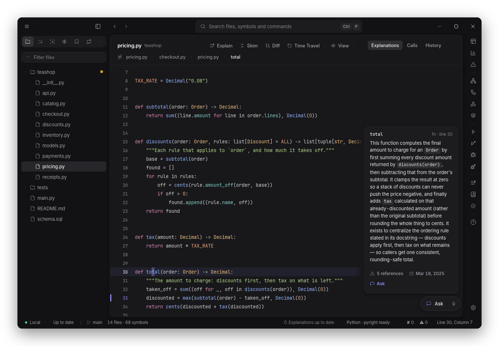
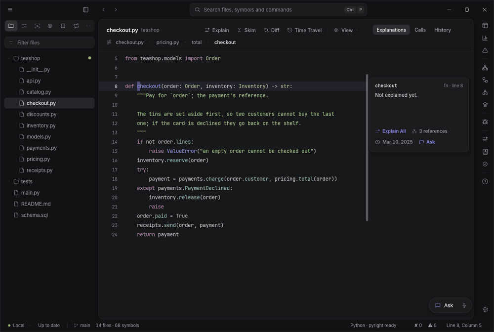
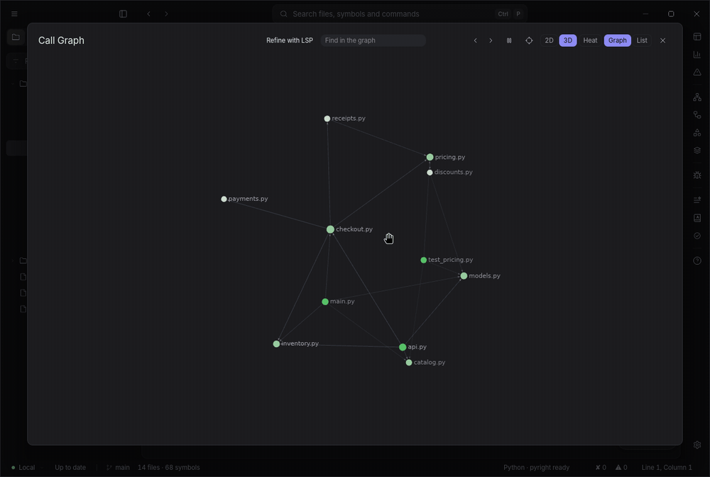
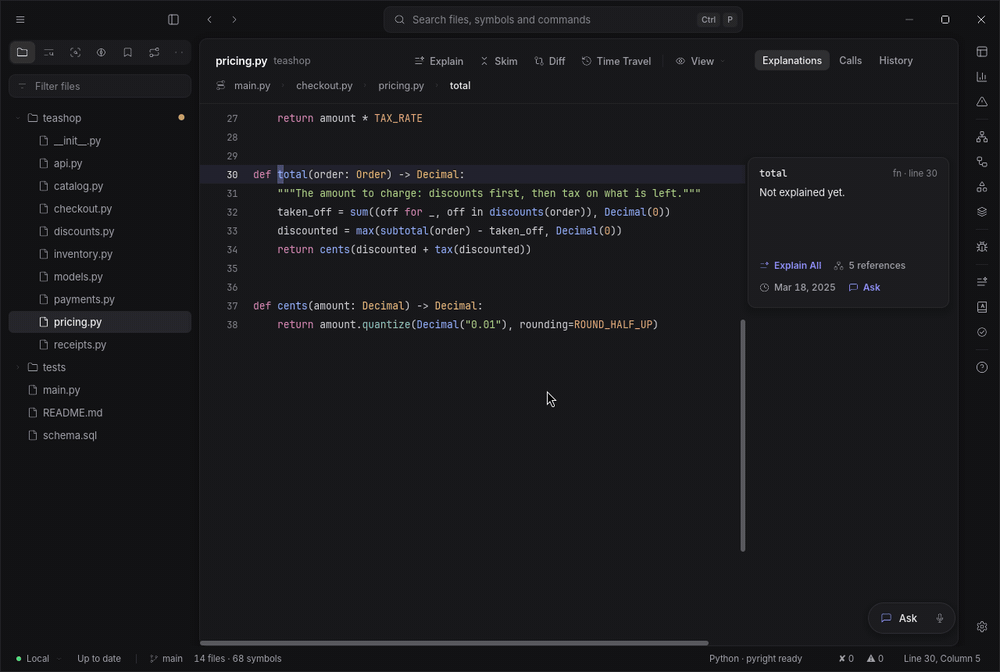
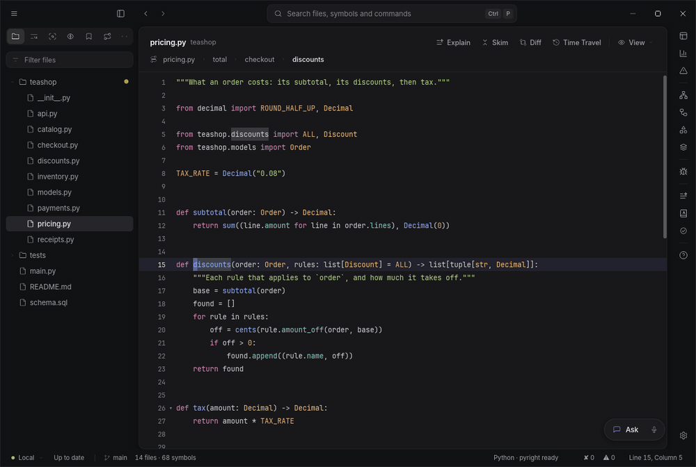
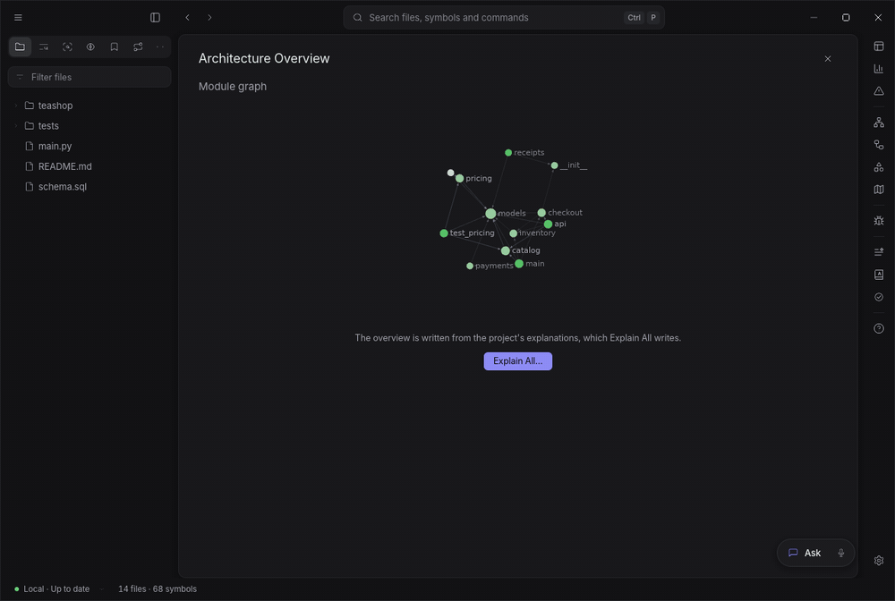

# Clew

**像写代码的人一样读懂任何代码库。**

[English](README.md) · **简体中文**

IDE 是你写代码的地方。 
Clew 是一个 **IUE**，即*集成理解环境*（Integrated Understanding Environment），是你读懂代码的地方。

## ✨ 亮点

| | |
|---|---|
| 🗺️ **看清全貌** | 架构概览，以及谁调用谁、谁导入谁的实时 3D 图 |
| 🧭 **知道从哪读起** | 阅读指南，以及任意流程的分步导览 |
| 💬 **有问必答** | 一个读过整个项目的智能体，并给出它读过的代码行 |
| 🕰️ **回到过去** | 让一个函数沿着 git 历史一步步倒退，并问它为什么改 |
| 🧪 **在脑中运行** | 按你给的输入一步步走完一个函数，而不真正运行它 |
| 🎙️ **直接说话** | 开口提问、听到回答，语音都留在你的电脑上 |

**支持** 任意 LLM · MCP 与 ACP · 15 种语言，从 Rust、Python 到 Haskell、Zig

## 看看效果

**就代码提问。** 回答会注明出自哪几行代码，点一下就跳过去。

**看清各部分如何连在一起。** 旋转调用图、在图里搜索，然后飞到某个文件。

**回到过去。** 让一个函数沿着历史一步步走，并问每次改动是为了什么。

**在脑中运行。** Clew 的模型按你描述的输入，一行一行地推演一个函数。

**手不离键盘。** **⌘J** 会在每个按钮上标出一个短代码，输入它就等于按下按钮。

## 开始使用

1. **下载** [最新版本](https://github.com/RutaTang/Clew/releases/latest)：macOS（Apple 芯片）下载 `.dmg`，Linux（x86-64）下载 `.tar.gz`。
2. **打开一个文件夹**，里面是你想读的代码；再在 **设置 → 语言模型** 中填入你的模型密钥。
3. **跟着教程走一遍**：按 **⌘⇧U**（Linux 上是 Ctrl+Shift+U），Clew 会在一个小示例项目上带你熟悉它。

在 Linux 上，Clew 需要 ALSA（`libasound2`）以及 X11 或 Wayland 桌面。把压缩包解压到任意位置后运行 `clew`，`clew-server` 和 `clew-speak` 要和它放在一起。

## 了解更多

[键盘操作](docs/keyboard.zh-CN.md) · [语音](docs/voice.zh-CN.md) · [MCP 与 ACP](docs/mcp-acp.zh-CN.md) · [语言支持](docs/languages.zh-CN.md) · [项目图](docs/project-graphs.zh-CN.md)

## 参与贡献

Clew 还很年轻，每一个 issue、想法和 pull request 都有帮助：[来提一个吧](https://github.com/RutaTang/Clew/issues)。
